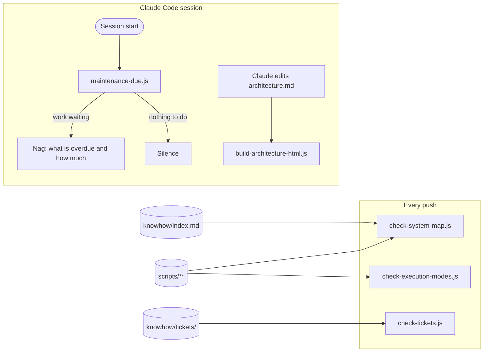
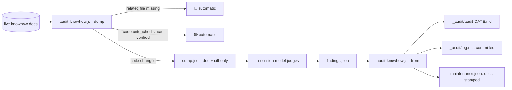

# System map

The visual map of the system. Mermaid diagrams plus prose; `architecture.html` is
generated from this file (never hand-edit it). A `PostToolUse` hook regenerates it
whenever Claude edits this file; outside a session, run
`node scripts/knowhow/build-architecture-html.js`.

Replace these diagrams with your own system's. They describe the skeleton itself.

## How the guards fit together

## The drift audit

